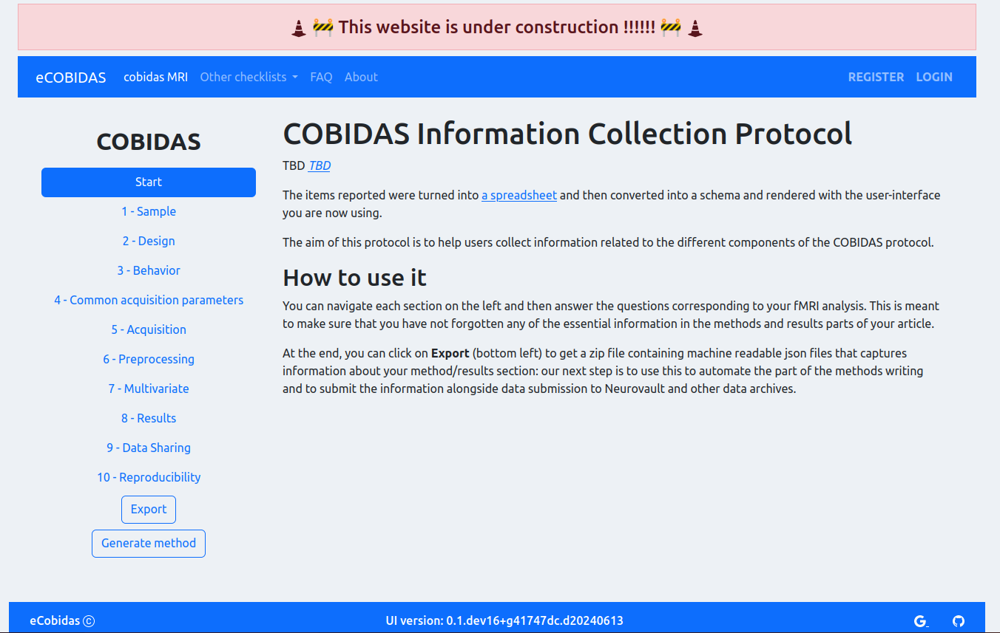
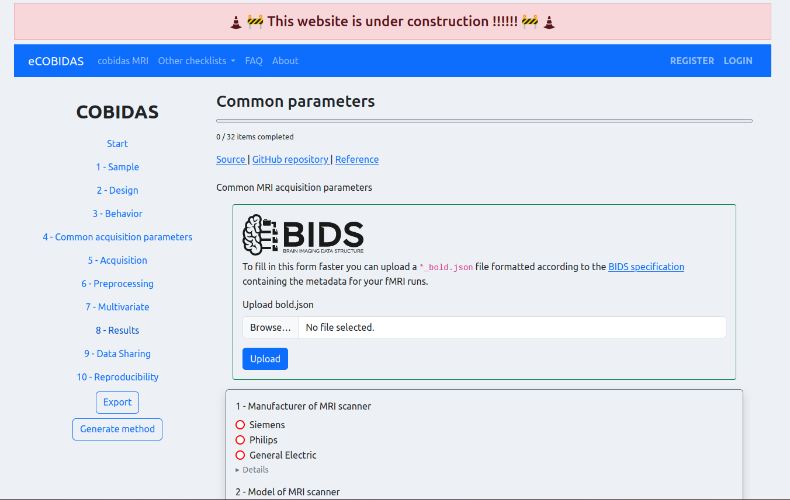
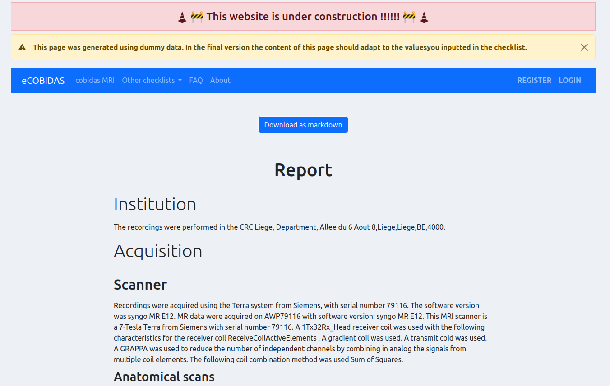

# 🚧 eCOBIDAS UI 🚧

🎉

This contains the code for a UI to run the eCOBIDAS checklist using Django.





## Install

Get the repo and all its submodules.

```bash
git clone --recurse-submodules https://github.com/Remi-Gau/ecobidas_ui.git
```

In a virtual environment install all the dependencies.

```bash
pip install -r requirements.txt
pip install -e .
```

## Serve locally

```bash
python manage.py runserver
```

Open the link `http://127.0.0.1:8000`

## Translations

Translations live in `ecobidas_ui/locale`.
Updating and compiling them requires [gettext](https://www.gnu.org/software/gettext/).

```bash
make messages          # extract new strings into the .po files
make compile_messages  # compile the .po files so Django can use them
```
